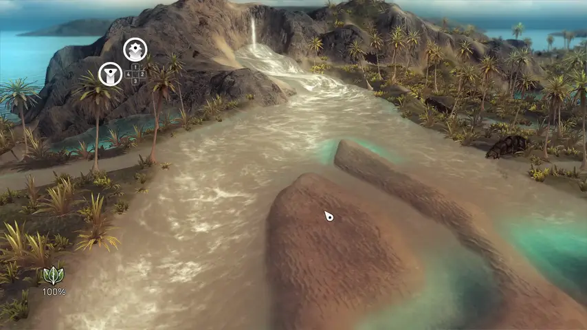
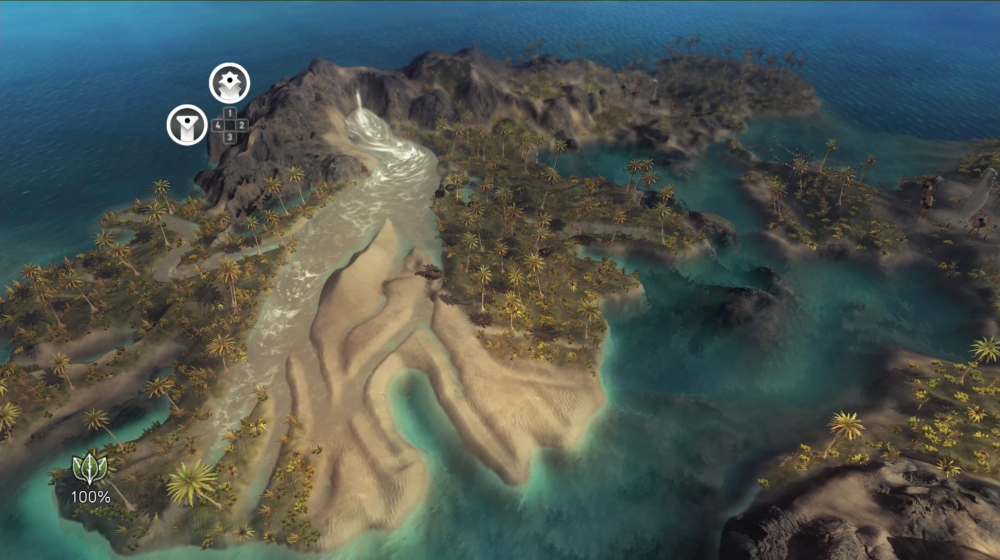
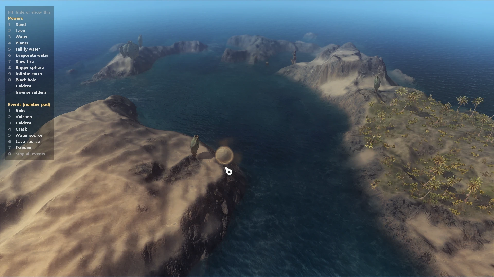

# From Dust SkoFix

A fix for modern systems.

  
  

## Features

**Performance**
- 60 FPS support (up to 120) with original simulation speed
- Frame rate independent game logic and effects
- Accurate frame pacing
- Deferred water and terrain simulation
- Hybrid CPU support (performance cores)

**Input**
- Raw mouse input without acceleration, smoothing or minimum step
- Screen-space cursor movement
- Optional standard mouse pointer
- Unrestricted camera rotation, without recentering on the cursor
- Removed object snapping and terrain slowdown for mouse
- Configurable edge panning and edge push-back
- Adjustable cursor and camera speed

**Graphics**
- Maximum model detail at all distances (terrain, vegetation, objects, villagers)
- Extended sun shadow distance
- Increased shadow resolution (2x, 4x)
- Shadows for small and distant objects
- Improved water: screen-space reflections, sun specular, detail ripples, smooth normals, full resolution refraction
- Adjustable water shimmer speed

**System**
- Borderless full screen with instant Alt+Tab
- High DPI support
- Skippable intro, videos and cutscenes
- Offline start without Ubisoft Connect
- Job queue race condition fix

**Extras**
- Sandbox mode
- Developer world editor (F2)
- World powers on the numeric keypad (experimental)
- Unlockable story maps and challenges

All features can be configured in `FromDust.SkoFix.ini`.

## Sandbox

The 13 story maps without goals, villagers or totems, with all powers and natural events. Story progress and challenges are not affected.

Press F3 in the main menu and select a map in Challenges. Press F3 again to restore the challenges.

| Key | Action |
|---|---|
| 1 2 3 4 | Sand, lava, water, plants |
| Shift, X (tap or hold) | Actions of the selected matter: mountains, calderas, volcanoes, sources, trees, tsunami |
| 5 6 7 8 | Jellify water, evaporate water, slow fire, bigger sphere |
| 9 0 - = | Infinite earth, black hole, caldera, inverse caldera |
| Number pad 1 2 3 4 | Rain, volcano, caldera, crack |
| Number pad 5 6 7 | Water source, lava source, tsunami |
| Number pad 0 | Stop all events |
| F4 | Hide or show the panel |

Can be disabled with `Sandbox=0`.

## Installation

1. Download the latest [release](https://github.com/skoinks/FromDust.SkoFix/releases).
2. Extract the archive into the game folder, next to `From_Dust.exe`.

To uninstall, delete `dinput8.dll` and `FromDust.SkoFix.*`.

## Compatibility

| Version | Status |
|---|---|
| Ubisoft Connect | Supported |
| Steam | Untested |

Tested on Windows 10. `From_Dust.exe` SHA-1: `8b9288f81c084853a77b4993a9fd8a968a3198fc`

## Reporting issues

Open an [issue](https://github.com/skoinks/FromDust.SkoFix/issues) and attach `FromDust.SkoFix.log`.

## Building

Requires Visual Studio 2022 with the C++ tools.

| Script | Purpose |
|---|---|
| `build.bat` | Builds `build/dinput8.dll` |
| `release.bat` | Packs `dist/FromDust.SkoFix.zip` |
| `shaders/build.py` | Compiles the water shaders (Windows SDK, Python) |
| `tools/watertest.bat` | Compares the water shaders with the originals |
| `tools/hang.py` | Analyzes a hang dump |

## License

[MIT](LICENSE)

Not affiliated with Ubisoft. From Dust is a trademark of Ubisoft Entertainment.
